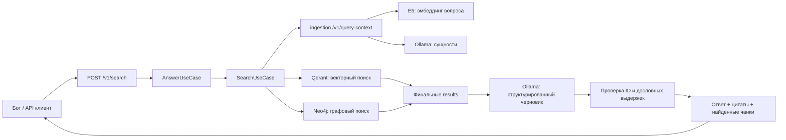

# Ответы с подтверждающими фрагментами

Генерация подключена к `POST /v1/search` через флаг `generate_answer: true`. Бот получает `answer.text` с цитатами рядом с фактами и структурированные `answer.facts`. Результаты поиска и их статусы остаются в том же ответе. Без флага сервис выполняет прежний поиск.

## Запуск

Подготовьте E5, Ollama, базы и ingestion по [инструкции запуска](../../ingestion-service/README.md#локальный-запуск-в-windows). Для демо с Atlas и Cedar нужен [корпус benchmark](../../benchmark/README.md#index-for-a-local-integration-run). Индексация — отдельная операция до поисковых запросов; существующие инструкции пересборки описывают удаление прежних индексов.

В терминале retrieval, из корня репозитория:

```powershell
cd retrieval-service
$env:NEO4J_PASSWORD = "local-dev-password"
$env:INGESTION_TIMEOUT = "50s"
$env:OLLAMA_URL = "http://localhost:11434"
$env:OLLAMA_MODEL = "qwen2.5:3b"
$env:ANSWER_TIMEOUT = "40s"
go run .\cmd\server
```

Пароль в примере относится к локальным тестовым базам; используйте фактический пароль своей установки. Файл `.env` используется Compose, Go не читает его автоматически. Модель должна быть установлена в Ollama. `GET /healthz` проверяет HTTP-процесс, а не доступность модели и баз.

| Настройка retrieval | По умолчанию | Назначение |
|---|---|---|
| `OLLAMA_URL` | `http://localhost:11434` | HTTP(S) адрес Ollama, без credentials, query и fragment |
| `OLLAMA_MODEL` | `qwen2.5:3b` | Модель ответа; не меняет отдельно запущенный ingestion |
| `ANSWER_TIMEOUT` | `40s` | Положительный HTTP timeout генерации |

HTTP write timeout учитывает `INGESTION_TIMEOUT + ANSWER_TIMEOUT + 30s` и составляет не менее 60s. Увеличение timeout не исправляет проблемы с качеством модели. Рекомендуется начинать с `limit: 3` и проверить входное окно модели на своей установке. Версии Go в модулях — 1.26.0; новый сторонний SDK не добавлен.

## Запрос и просмотр источников

Из нового терминала:

```powershell
$request = @{
  query = "Which company partnered with Acme to expand Aurora production?"
  strategy = "vector"
  limit = 3
  generate_answer = $true
} | ConvertTo-Json
$response = Invoke-RestMethod -Method Post -Uri http://127.0.0.1:8080/v1/search -ContentType "application/json; charset=utf-8" -Body ([System.Text.Encoding]::UTF8.GetBytes($request))
$response.answer | ConvertTo-Json -Depth 10
$response.results | Select-Object id, document_id, text
```

`answer.text` — Markdown с внутренними ссылками. Чтобы ссылка открывала фрагмент в интерфейсе бота, присвойте соответствующему элементу `results` идентификатор `chunk-<hex UTF-8 id>`. Например, `id: "a"` соответствует `href: "#chunk-61"`. Не подставляйте ID, имя файла или содержимое документа в HTML без экранирования. API не хранит ответ между запросами и не предоставляет отдельный URL загрузки чанка.

Для проверки в терминале можно сопоставить цитаты с полным текстом по ID:

```powershell
foreach ($fact in $response.answer.facts) {
  $fact.text
  foreach ($citation in $fact.citations) {
    $response.results | Where-Object { $_.id -eq $citation.chunk_id } | Select-Object id, document_id, text
  }
}
```

## Сценарий демо

Используйте `vector`, `limit: 3`, `generate_answer: true` и заранее загруженный benchmark-корпус. Это ручные примеры для проверки интеграции, не измеренный результат модели.

| Сценарий | Вопрос | Что проверить |
|---|---|---|
| Один источник | Which company partnered with Acme to expand Aurora production? | Цитата о Northstar, ID из возвращённых `results`, фрагмент из `01_acme_launch.md` |
| Несколько источников | What did Atlas Components supply, and what did Cedar Plastics supply for Aurora? | Отдельные факты и ссылки на `06_atlas_processors.md` и `07_cedar_packaging.md` |
| Частичный ответ | What did Acme launch in 2023, and what was Aurora production volume in 2024? | Подтверждён запуск Aurora; объём производства обозначен в `missing`, `answer.status: partial` |
| Нет ответа | Did Acme acquire Harbor Logistics in 2022? | `insufficient_data`, без утверждения, что сделки точно не было, даже если поиск вернул похожие документы |
| Отказ модели | Укажите временно недоступный `OLLAMA_URL` при доступных ingestion и базах | `answer.status: error`, результаты поиска доступны; это не отсутствие сведений |

Для повторения запросов меняйте `$request`, затем снова выполняйте `Invoke-RestMethod`. UUID чанков меняются после пересборки. Для сопоставления источников используйте `results[].metadata.source`; ссылки в конкретном ответе всегда используют текущие ID чанков.

При проверке частичного ответа убедитесь, что модель перечисляет пропущенную часть вопроса в `missing`. Статус `complete` означает только наличие принятых фактов и отсутствие пропусков, отмеченных моделью или валидатором. Он не является доказательством полноты ответа.

## Архитектура бэкенда



При выключенном флаге ветка генерации пропускается. Пустая выдача успешно выполненного поиска сразу даёт `insufficient_data`. Для остальных запросов `AnswerUseCase` передаёт генератору только вопрос и финальные пары ID/текст. Ни ссылки графа на невыданные чанки, ни метаданные не расширяют контекст.

Модель выбирает дословные релевантные выдержки и цитирует неподтверждённые части вопроса в `missing`. Сервер допускает в этом поле только буквальные выдержки из вопроса и собственные фиксированные диагностические сообщения. Поэтому произвольное объяснение модели не может обойти проверку фактов через `missing`.

Сервер самостоятельно строит ссылки, проверяет каждый ID и наличие полного текста факта в каждом указанном чанке. Факт с неподтверждённой ссылкой удаляется целиком; оставшиеся факты сохраняются со статусом `partial`. Если подтверждённых фактов не осталось после успешно выполненного поиска, ответ сообщает о недостатке данных. Если один путь поиска сломался, а другой был пропущен, ответ получает `error`, поскольку документы проверить не удалось. Некорректный JSON, HTTP ошибка, timeout и незавершённая генерация также дают `error`.

Целевое расширение после MVP — отдельная семантическая проверка перефразированных утверждений, перевода, вычислений и многошаговых выводов. Она должна опираться на тот же контракт финального контекста и не принимать ID вне него. Замеры индексации, поиска, генерации и проверки нужно проводить отдельно; данная реализация не устанавливает узкие места производительности.

## Проверки и ограничения

Из соответствующего модуля:

```powershell
go test ./... -count=1
go vet ./...
go build ./...
```

Тест `TestAnswerHTTPIntegration` использует настоящие HTTP router, ingestion/Qdrant/Ollama клиенты, поиск и валидатор. Внешние процессы заменены локальными HTTP-фикстурами, Neo4j — тестовым адаптером. Проверяются один и два источника, частичный ответ, нерелевантный найденный чанк, пустая выдача, полностью недоступный поиск, неверный ID, неподтверждённый текст, ошибки и обрезка модели, legacy и частичный hybrid. Отдельные тесты проверяют лимиты, отмену, защиту `missing`, многострочные цитаты, конфигурацию и сборку обработчика сервера.

Автотесты подтверждают контракт и фильтрацию, но не качество настоящей Qwen. В рабочей среде отдельно проверяются релевантность выдержек, полнота `missing`, русский язык, ссылки в интерфейсе бота и совместимость Ollama. Экстрактивный MVP не переводит источники и не вычисляет новые факты, например разницу выручки из двух значений. Дословность не предотвращает подбор вводящей в заблуждение части предложения; перед показом результата оцените его в контексте полного чанка.

Ollama version и digest модели не закреплены; неизвестные поля ответа отклоняются. Клиент задаёт `num_ctx: 16384`, ограничивает сериализованный вопрос с чанками 12 KiB, резервирует 2048 токенов ответа и передаёт `truncate: false`, `shift: false`. При превышении байтового лимита генерация завершается с `error`, результаты поиска сохраняются. Это консервативное ограничение для Qwen, а не универсальный токенизатор. Совместимость конкретной версии Ollama с этими полями и token window другой модели нужно проверить перед сменой модели; старые версии могут игнорировать неизвестные параметры. Реальная модель в автоматических проверках не запускалась. Внешнего интерфейса в этом репозитории нет; проверки UI и Playwright не выполнялись.
